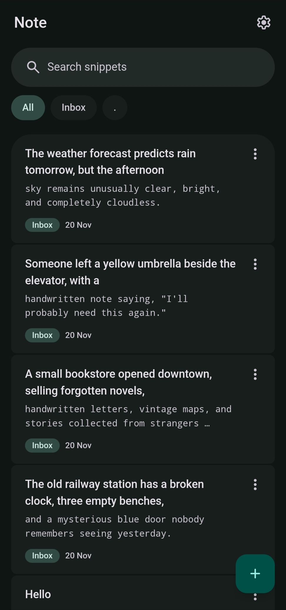
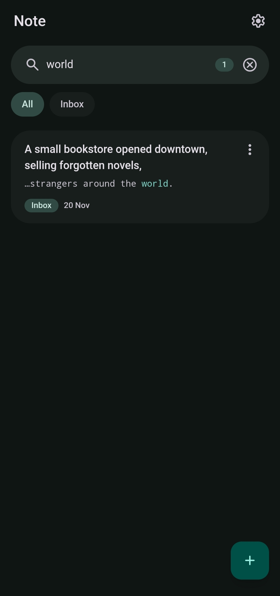
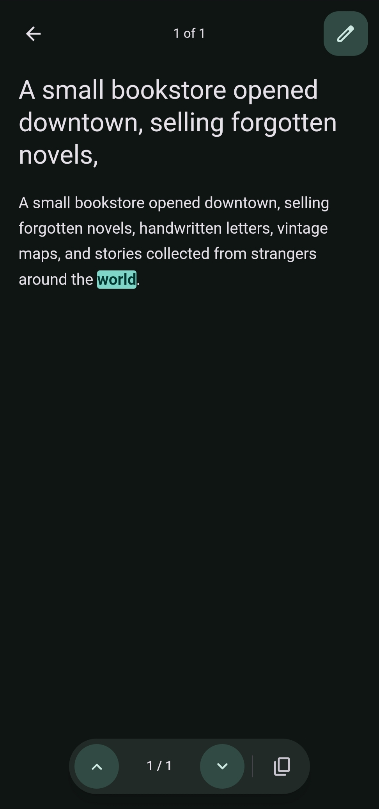
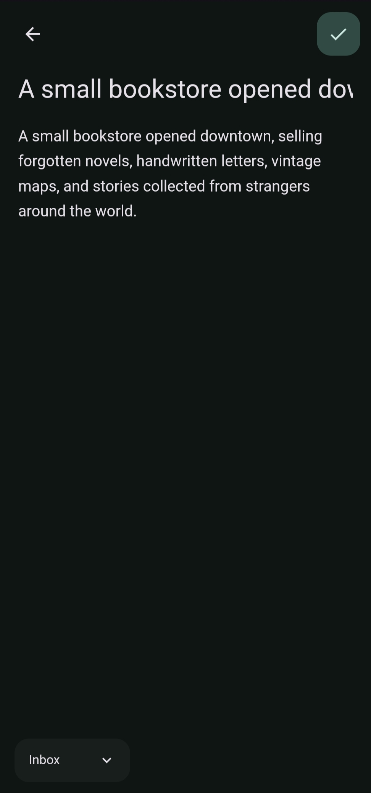

# Note App

---

This is a simple app built with React.

**Q: Why did I build this?**

> A: There is not a single note app that I'm satisfied with.

**Q: Why am I not satisfied?**

> A: I need a note app where I can quickly copy and search my notes (like fzf). I may not be able to explain it well, but you can see some images at the bottom of this README.

I mostly use a note app because my dumbass forgets a lot of things, so I have to write them down.

**Q: Why should I use it?**

> A: If you're facing this type of problem:

1. You always need to copy and paste.
2. You need something minimalistic, but with a good UI.

**Q: Is this for long notes or short snippets?**

> A: It's built mainly for short, searchable snippets that you want to remember or quickly copy and paste later. The editor support even longer text with no problem.

**Q: Does it work offline?**

> A: Yes, this "app" stored in your browser's local database (indexedDB) so it stored locally so it can be run offline. After you've loaded the app once online, you can reopen it and read or edit your notes offline. GitHub sync needs an internet connection, so offline changes stay local until you're back online.

**Q: Can I copy just the matched part, or only the whole note?**

> A: Long-press a note in the list and it will copy for you. You can also select just the part you want to copy.

**Q: Can I back up, export, or sync between devices?**

> A: Yes.

**Q: Does it support Markdown?**

> A: No.

**Q: Why are some titles and previews cut off mid-sentence (like "...selling forgotten novels,")?**

> A: This is the most interesting part of the app. The preview under each title normally shows the start of the note. When you search for a word that isn't in that preview (like "novels"), the preview shifts to show the part of the text where the word is, so you can see the match right away.

**Q: Do you use AI/LLMs?**

> A: I did. To be honest, in this era many people use AI, but it's not 100% vibe coded, so you might find some vulnerabilities.

---

I built this app to fill my own needs at work, so some people might not like it. I will try my best to improve it.

The problem is that it's just a PWA, so the initialization time is about 3 seconds. I need a developer who can port this into a lightweight Android app. I don't have any knowledge about Android development, so I didn't go that way.

> "But you said you used AI to build it. Why not let the AI build the Android app?"

I don't have any knowledge about Android development, and I don't trust AI when I don't know what I'm doing.

---

| | |
|:--:|:--:|
|  |  |
|  |  |

